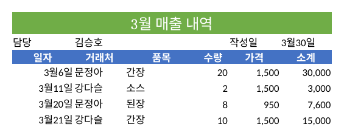
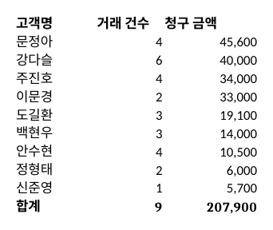
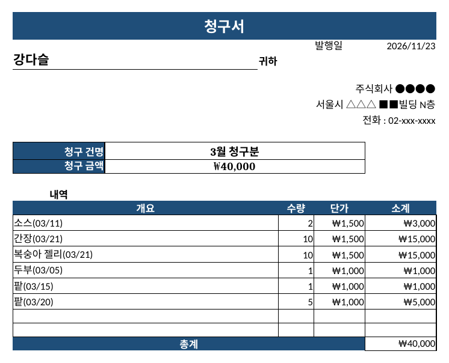

# 請求書発行の自動化 / 고객별 청구서 발행 자동화

**担当者ごとにバラバラな売上Excelを集計し、顧客ごとの請求書を自動で発行する Python プログラム**<br>
담당자별로 흩어진 매출 엑셀을 모아, 고객별 청구서를 자동으로 발행하는 파이썬 프로그램

> 栄進専門大学「AI自動化プログラミング(I)」の授業実習をもとに、**請求サマリー表（④）を自分で追加**しました。<br>
> 영진전문대 「AI자동화프로그래밍(I)」 수업 실습을 바탕으로, **청구 요약표(④) 기능을 직접 추가**했습니다.

---

## 🔄 処理の流れ / 처리 흐름

```
input/salesbooks/*.xlsx （担当者5人の売上 / 담당자 5명 매출）
        │
        ▼  ① step1_merge.py      1つのシートに集約 / 시트 하나로 모으기
output/merge_file.xlsx
        │
        ▼  ② step2_aggregate.py  顧客別に分類・金額集計 / 고객별 분류·금액 집계
output/customers.json
        │
        ├─▶ ③ step3_invoice.py   テンプレートに入力して顧客別の請求書を発行
        │                         템플릿에 채워 고객별 청구서 발행  → output/invoice/<고객명>.xlsx
        │
        └─▶ ④ step4_summary.py   請求サマリー表（追加機能）/ 청구 요약표 (추가 기능)
                                  → output/summary.xlsx
```

`python main.py` を実行すると ①〜④ が順番に動きます。 / 한 번 실행으로 ①~④가 순서대로 동작합니다.

---

## 🖼 実行結果 / 실행 결과

| 入力：担当者の売上 / 입력: 담당자 매출 | 追加機能：請求サマリー / 추가 기능: 청구 요약 |
|---|---|
|  |  |

**出力：顧客ごとの請求書 / 출력: 고객별 청구서**



---

## 💡 工夫したところ / 신경 쓴 부분

- **④ 請求サマリー表（追加）**：請求書は顧客ごとにファイルが分かれるため、今月の請求状況を1枚で確認できるよう、金額の大きい順に並べて合計も表示<br>
  청구서는 고객마다 파일이 따로라서, 이번 달 청구 현황을 한 장으로 볼 수 있게 금액 큰 순으로 정렬하고 합계도 표시
- **3万ウォン以上の顧客を黄色で強調**（授業「Excel自動化3」の条件付き書式を応用）<br>
  청구 금액 3만 원 이상 고객을 노란색으로 강조 (수업 「엑셀자동화3」의 조건부 서식 응용)
- **どこから実行しても動く**：`__file__` 基準でパスを作成 / 실행 위치와 관계없이 동작하도록 파일 기준 경로 사용
- **Excelの一時ファイル（`~$`）を除外**：ファイルを開いたままでもエラーにならない / 엑셀을 열어 둔 상태에서도 오류 없음
- **明細が8行を超えたら警告** / 내역이 템플릿 칸(8줄)을 넘으면 경고
- **ステップごとにモジュール化**：各ファイルは単独でも実行でき、`main.py` から順番に呼び出す<br>
  단계별 모듈 분리 — 각 파일을 따로 실행할 수도 있고, `main.py`에서 순서대로 호출

---

## ▶️ 実行方法 / 실행 방법

```bash
pip install -r requirements.txt
python main.py
```

結果は `output/` フォルダに作成されます。 / 결과는 `output/` 폴더에 만들어집니다.

> サンプルの入力ファイルを作り直したいときは `python make_sample.py`（データはすべて架空）<br>
> 샘플 입력 파일을 다시 만들고 싶으면 `python make_sample.py` (데이터는 모두 가상)

---

## 📂 構成 / 폴더 구조

```
├─ main.py               # ①〜④を順番に実行 / 전체 실행
├─ step1_merge.py        # ① 売上の集約 / 매출 모으기
├─ step2_aggregate.py    # ② 顧客別集計 / 고객별 집계
├─ step3_invoice.py      # ③ 請求書発行 / 청구서 발행
├─ step4_summary.py      # ④ 請求サマリー（追加）/ 청구 요약 (추가)
├─ make_sample.py        # サンプル入力の作成 / 샘플 입력 만들기
├─ input/
│  ├─ salesbooks/        # 担当者別の売上Excel / 담당자별 매출 엑셀
│  └─ invoice-template.xlsx
└─ docs/images/          # README用の画像
```

## 🛠 Tech

Python 3, openpyxl, json
